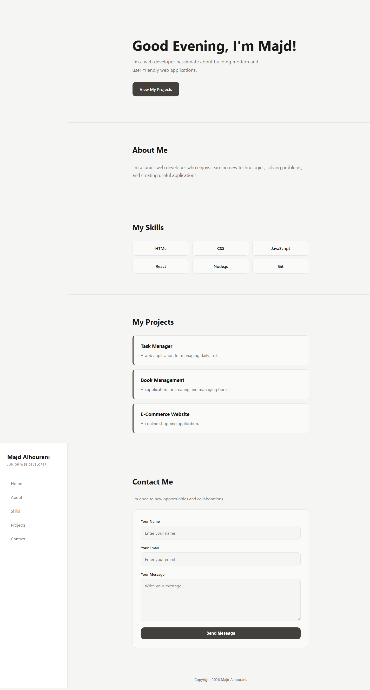

# Majd Alhourani – Portfolio

A personal portfolio website built with React and Vite. It introduces the developer, lists skills and projects, and includes a contact form. The page greets visitors based on the time of day.



## Features

- Time-based greeting (Good Morning / Afternoon / Evening)
- Fixed sidebar navigation with smooth scrolling to each section
- Sections: Home, About, Skills, Projects, Contact
- Contact form with name, email and message fields
- Responsive layout (the sidebar becomes a top bar on small screens)
- Stone color palette with simple, readable CSS

## Tech Stack

- [React](https://react.dev/) 19
- [Vite](https://vite.dev/) 8
- ESLint (with React Hooks and React Refresh plugins)
- Plain CSS

## Getting Started

### Prerequisites

- [Node.js](https://nodejs.org/) (a recent LTS version)
- npm

### Installation

Clone the repository and install the dependencies:

```bash
git clone https://github.com/majd-hourani/jsx.git
cd jsx
npm install
```

### Run in development

```bash
npm run dev
```

Then open the local URL printed in the terminal (usually `http://localhost:5173`).

### Other scripts

| Command           | Description                          |
| ----------------- | ------------------------------------ |
| `npm run dev`     | Start the development server         |
| `npm run build`   | Create a production build in `dist/` |
| `npm run preview` | Preview the production build locally |
| `npm run lint`    | Run ESLint on the project            |

## Project Structure

```
.
├── index.html
├── package.json
├── project.png       # Screenshot used in this README
└── src/
    ├── main.jsx      # App entry point
    ├── main.css      # Global/page styles
    └── App.jsx       # Portfolio component
```

> The stylesheet is loaded in `main.jsx` as `./main.css`. If your styles live in `App.css`, rename it to `main.css` or change the import.

## Customization

All personal content is defined at the top of `App.jsx`:

- `firstName`, `lastName`, `jobTitle`
- `introduction` and `aboutMe`
- `skills` (array of strings)
- `projects` (array of `{ name, description }`)

Colors are defined as CSS variables in the `:root` block of the stylesheet, so you can change the whole theme from one place.

## Notes

- The contact form is front-end only and does not send messages yet. Connect it to a backend or a form service to make it work.
- The message field currently has `maxLength={50}`; increase it if you want longer messages.

## Author

**Majd Alhourani** – Junior Web Developer

## License

This project is for personal use.
